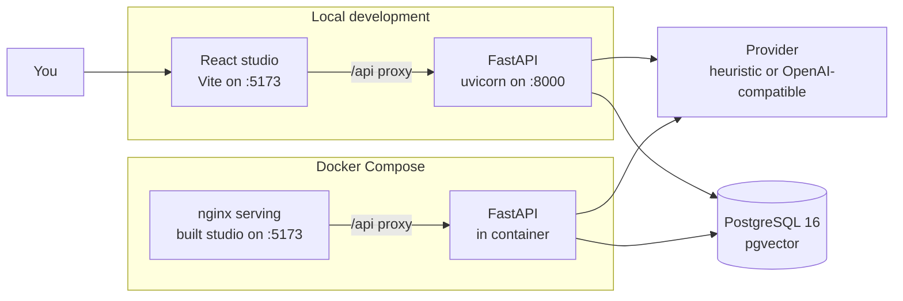
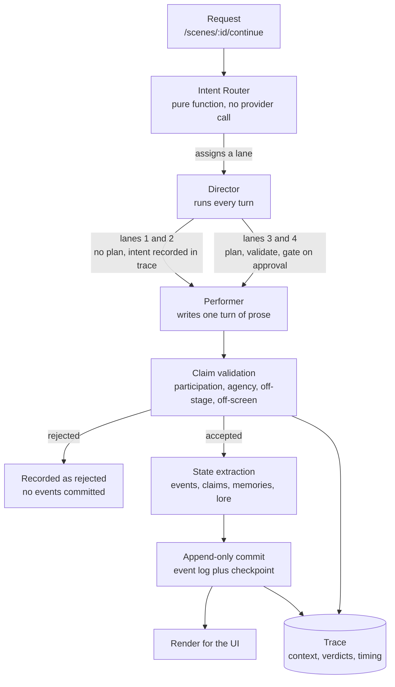
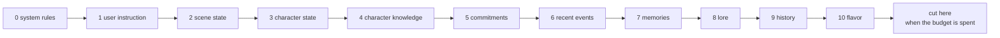
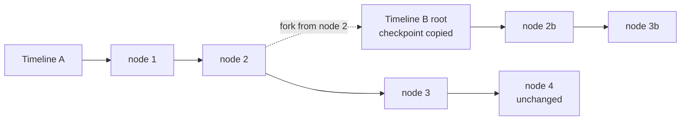

# AI Narrative Studio

AI Narrative Studio is a self-hosted, single-user narrative simulation studio for actors, directors, narrators, writers, and world authorities. It is designed as a simulation desk rather than a chat client: the user controls narrative intent and fictional authority, while structured events, checkpoints, memories, and state projections control what is true.

The current repository contains the MVP foundation and first complete narrative workflow:

- Project, world, timeline, scene, character, source, and state persistence
- Append-only event history with checkpoint snapshots
- Non-destructive timeline branching and regeneration on a branch
- Character Card V1 and V2 import
- JSON, PNG, and APNG embedded card import
- Character books and standalone lorebooks
- Structured lorebook activation with an inspectable debug view
- Five memory classes with bounded retrieval
- Context assembly with priorities, budgets, and per-generation traces
- Character knowledge isolation with suspicion kept apart from certainty
- Story commitment lifecycle with branch-scoped forks
- Deterministic long-running evaluation across five canonical scenarios
- Local heuristic provider for offline development
- OpenAI-compatible provider adapter for local and generic endpoints
- Scene staging with explicit assumptions and approval
- Director intent stored as a pending story commitment
- User possession of any scene participant
- Canon divergence records
- Desktop-first React studio with cast, performance, state, timeline, and director controls

## Verification Status

Every number below was produced on Windows 11 by the commands in
[Testing and Quality Checks](#testing-and-quality-checks), against a fresh
virtual environment created from `.env.example`.

| Check | Command | Result |
| --- | --- | --- |
| Python suite | `pytest` | 350 passed, 13 skipped |
| Migrations | `pytest tests/test_migrations.py` | 8 passed |
| Engine evaluation | `python -m services.evaluation.harness --print` | 20/20 runs pass (5 scenarios at 10, 25, 50, 100 turns), 0 invalid events, 0 knowledge leaks, 0 branch leaks |
| Director evaluation | `python -m services.evaluation.director --print` | 8/8 scenarios |
| Performer evaluation | `python -m services.evaluation.performer --print` | 10/10 scenarios |
| Lint | `ruff check apps services packages tests alembic` | clean |
| Types | `mypy apps services packages` | clean, 56 files |
| Web types and build | `npm run web:lint`, `npm run web:build` | clean |
| API startup and one full turn | `uvicorn`, then stage, approve, continue, inspect | 3 events committed, `adapter: heuristic` |

The API startup check ran against SQLite because no PostgreSQL server was
available on that machine. The engine is the same code on both; the Postgres
suite below is the one that covers what SQLite does not reproduce.

These suites assert behaviour against scripted providers. **Passing them is not
a claim that the prose is good.** That still needs a human reading the output,
and the heuristic provider writes templated text by design.

There is no JavaScript test runner. Frontend behaviour is covered by server
contract tests plus type checking and a successful build, so UI regressions are
verified manually rather than automatically.

### Known limitations

| Limitation | Status |
| --- | --- |
| `_recent_events` is scoped to the active scene per ADR 0004, but `_overhear` grants no suspicion for a paraphrase | **Partially closed.** `test_recent_events_hide_speech_from_another_scene` replays the measured cross-scene leak; within-room speech stays visible by design. The paraphrase accounting gap is still open |
| No authentication; Compose binds all interfaces and publishes PostgreSQL on `5432` | Open. Bind to loopback before any shared deployment — see [Security Before Publishing](#security-before-publishing) |
| Unbounded request body size; uploads spool to disk before the 413 | Open |
| `creator_notes` and card text reach prompts without a trust boundary; over-long card descriptions are rejected rather than truncated | Open. Needs a trust-boundary design, not a patch |
| Context budget can starve character state, and trims the knowledge guardrail it still describes as exhaustive | Open |
| Performer output is never validated against the Director constraint envelope; exclusions are prompt-only | Open |
| Structured output is prompt-injected and parsed with a bare `json.loads`; no `response_format`, no brace salvage, so a model that buries JSON in commentary fails the generation | Open. One markdown fence pair is stripped before parsing, and a failed Performer call is retried twice with its validation errors fed back. A 4B model returned a complete and correct object inside a fence; that shape now parses. Ollama supports `response_format` natively and the adapter does not use it yet. See `docs/PROVIDERS.md` |
| `active_director_plan` has no timeline predicate after a fork | Open |
| No CI workflow | Open |

## Product Model

The application keeps these distinctions separate:

| Concept | Meaning |
| --- | --- |
| Character definition | Stable imported or authored identity and prompt material |
| Character state | Facts currently true for a character on a timeline |
| Source material | Advisory canon that informs generation |
| World state | Facts created or changed by committed events |
| Director intent | A desired future direction, not an immediate literal action |
| Story commitment | An open outcome the planner must continue to pursue |
| Timeline | An ordered event history with checkpoints |
| Transcript | Presentation text, not the source of truth |
| Memory | Classified information selected for bounded context |
| Lorebook | Structured retrieval rules, not a flat text appendix |

The normal flow is:

```text
Premise
  -> intent classification
  -> context retrieval
  -> scene staging
  -> user approval
  -> actor selection
  -> provider generation
  -> structured validation
  -> state extraction
  -> memory updates
  -> immutable event commit
  -> checkpoint
  -> render
```

The first four steps are the setup boundary. A staged scene cannot continue
until you record the approval, so an underspecified premise never becomes a
committed event by accident. See [Architecture](#architecture) for the same flow
with the decision points drawn.

## Architecture

Two processes and one database. There is no message queue and no worker pool:
a turn is a single request that runs the pipeline synchronously and commits when
it finishes.



The two setup paths differ only in who starts the API process and the database.
The Python code is identical in both.

Inside one API process, a turn moves through four layers. Each one has a single
job and hands a validated result to the next.



### Why a turn is not one call to a model

The Performer proposes and never commits. Everything the model returns is a
claim that has to survive four checks before it becomes an event, because the
model fills in the fields that would otherwise enforce the rules. `kind` is
model-authored, so possession authority is decided from the user's own input
instead. The event vocabulary the model is shown is derived from the enum the
engine accepts, so a schema-compliant name cannot be rejected wholesale.

### Context is a priority ladder, not a truncation

A prompt is assembled from independently sourced facts, each tagged with a
priority. When the token budget runs out, the assembler drops or summarises from
the bottom of the ladder up and records why, so the context panel can answer
"why is this not in the prompt".



### Branching never edits history

A fork copies an immutable source node into a new timeline and appends only to
the branch. Character state is a derived projection that can be rebuilt from
events, so the source timeline is never rewritten.



## Technology

- Python 3.12 or newer
- FastAPI
- SQLAlchemy 2.x
- Alembic
- PostgreSQL 16 with pgvector
- React, TypeScript, and Vite
- pytest, Ruff, and mypy
- Docker Compose for the self-hosted stack

The application is a modular monolith. It does not require Redis, Kafka, Kubernetes, or a distributed worker for the MVP.

## Repository Layout

```text
apps/
  api/                 FastAPI application and database wiring
  web/                 React/Vite studio
packages/
  schemas/             Shared API contracts
  core/                Reserved shared package boundary
services/
  core/                SQLAlchemy entities, events, and state projection
  narrative/           Narrative pipeline orchestration
  importers/           Character card and lorebook normalization
  lorebook/            Structured activation and debug output
  memory/              Memory classification and retrieval
  providers/           Provider protocol and HTTP adapter
alembic/               Database migrations
tests/                 Deterministic SQLite tests and the opt-in PostgreSQL suite
docs/                  Product, API, and architecture documentation
```

## Requirements

Pick one row. Both paths run the same code and serve the same studio.

| | [Docker Compose](#quick-start-with-docker) | [Local development](#local-development) |
| --- | --- | --- |
| Install | Docker Desktop | Python 3.12+, Node.js 20+, PostgreSQL 16 |
| Processes you start | one | three (database, API, studio) |
| Reloads code on save | no, rebuild the image | yes |
| Good for | trying it, deploying it | working on it |

PostgreSQL needs the `pgvector` extension. The Compose image already has it.
For a local install, use the `pgvector/pgvector:pg16` image through
`docker compose up -d postgres` rather than installing the extension by hand.

Node.js 20 or newer is required. The workspace uses npm workspaces, so run
`npm install` once at the repository root.

## Quick Start with Docker

Docker Compose starts PostgreSQL with pgvector, applies migrations, starts the
API, and serves the built studio through nginx.

### Windows (PowerShell)

1. Copy the environment template:

   ```powershell
   Copy-Item .env.example .env
   ```

2. Build and start the stack. The first build takes a few minutes:

   ```powershell
   docker compose up --build
   ```

3. Open the studio at <http://localhost:5173> and the API docs at
   <http://localhost:8000/docs>.

4. Stop the services:

   ```powershell
   docker compose down
   ```

   Add `-v` to also delete the PostgreSQL volume, which destroys your local
   narrative data.

### macOS and Linux

1. Copy the environment template:

   ```bash
   cp .env.example .env
   ```

2. Build and start the stack:

   ```bash
   docker compose up --build
   ```

3. Open the studio at <http://localhost:5173> and the API docs at
   <http://localhost:8000/docs>.

4. Stop the services with `docker compose down`. Add `-v` to delete the
   PostgreSQL volume too.

### About `.env` on this path

You do not need to edit it. The default provider is the deterministic heuristic
provider, so the first run needs no model account. Provider settings from `.env`
are passed into the Compose API service, so adding a key there is enough to
switch providers without rebuilding.

The database URL in `.env` is for a locally running API. Compose overrides it
with the internal `postgres` hostname, which only resolves inside the network.

## Local Development

You run three processes: the database, the API, and the studio. Keep three
terminals open.

### 1. Create a Python environment

Windows (PowerShell):

```powershell
python -m venv .venv
.venv\Scripts\Activate.ps1
```

macOS and Linux:

```bash
python3 -m venv .venv
source .venv/bin/activate
```

If PowerShell blocks the activation script with an execution-policy error, either
run `Set-ExecutionPolicy -Scope CurrentUser RemoteSigned` once, or skip activation
and call the interpreter directly as `.venv\Scripts\python.exe` in the commands
below. Both work.

### 2. Install Python dependencies

```text
python -m pip install --upgrade pip
python -m pip install -e ".[dev]"
```

The `[dev]` extra brings pytest, ruff, and mypy. Without it the app still runs
and the test commands are unavailable.

### 3. Configure the environment

Windows (PowerShell):

```powershell
Copy-Item .env.example .env
```

macOS and Linux:

```bash
cp .env.example .env
```

The file works as copied. It ships the heuristic provider and leaves credentials
empty, so nothing has to be filled in before the first run.

Until you configure a provider key, the studio shows a banner saying responses
are templated rather than written. That is expected on a fresh install.

The API reads environment variables with the `NARRATIVE_` prefix, and `.env` is
loaded automatically. Settings are read once at process startup, so restart the
API after editing it. The important ones:

| Variable | Purpose | Default |
| --- | --- | --- |
| `NARRATIVE_DATABASE_URL` | SQLAlchemy URL, PostgreSQL or SQLite | Local `narrative` database |
| `NARRATIVE_CORS_ORIGINS` | Comma-separated allowed web origins | `http://localhost:5173` |
| `NARRATIVE_PROVIDER` | `heuristic`, `openai_compatible`, `openai-compatible`, `local`, `ollama`, or `generic`; anything else falls back to `heuristic` | `heuristic` |
| `NARRATIVE_PROVIDER_BASE_URL` | OpenAI-compatible API base URL; must include any `/v1` prefix | Empty |
| `NARRATIVE_PROVIDER_MODEL` | Model identifier sent to the provider | Empty |
| `NARRATIVE_PROVIDER_API_KEY` | Provider credential read from the environment; leave empty for local servers | Empty |
| `NARRATIVE_PROVIDER_CONTEXT_WINDOW` | Declared context window in tokens; `0` uses the conservative default | `0` |
| `NARRATIVE_PROVIDER_MAX_OUTPUT_TOKENS` | Reserved output budget in tokens; `0` uses the default | `0` |
| `NARRATIVE_PROVIDER_FEATURES` | Comma-separated declared features (`structured_output`, `streaming`, `tools`, `json_mode`, `embeddings`); declaration only, it does not change the request | Empty |
| `NARRATIVE_PROVIDER_TIMEOUT_SECONDS` | Per-request provider timeout in seconds; raise it for CPU-only local inference | `120` |
| `NARRATIVE_MEMORY_RETRIEVAL_LIMIT` | Memories injected per turn | `10` |
| `NARRATIVE_MEMORY_CANDIDATE_POOL` | Candidate pool ranked per retrieval | `400` |
| `NARRATIVE_LORE_TOKEN_BUDGET` | Lore budget hint; lore is additionally capped at a fifth of the input budget | `2048` |
| `NARRATIVE_AUTO_CREATE_SCHEMA` | Create tables on API startup | `false` |

The two numeric provider fields accept an empty value, which means "not
declared" and falls back to the conservative default.

Keep `NARRATIVE_AUTO_CREATE_SCHEMA=false` and use Alembic for schema changes.

### 4. Start PostgreSQL

If you have PostgreSQL 16 with pgvector installed, create a database matching the
URL in `.env`. Otherwise start only the Compose database, which needs Docker but
not the full stack:

```text
docker compose up -d postgres
```

To skip PostgreSQL entirely, point the API at SQLite. This is enough for the UI,
the heuristic provider, and local exploration. It does not reproduce
`pgvector`, immediate foreign key enforcement, or partial unique indexes, so run
the [opt-in PostgreSQL suite](#the-opt-in-postgresql-suite) before trusting
anything those affect. An environment variable wins over the same key in
`.env`, so this overrides the Postgres URL copied in step 3 for this shell:

```bash
export NARRATIVE_DATABASE_URL=sqlite:///./narrative.db
```

```powershell
$env:NARRATIVE_DATABASE_URL = "sqlite:///./narrative.db"
```

### 5. Apply migrations

```text
alembic upgrade head
```

Alembic reads the same `NARRATIVE_DATABASE_URL`, so it migrates whatever
database you configured.

### 6. Start the API

```text
uvicorn apps.api.app.main:app --reload --port 8000
```

Check `http://localhost:8000/health`. It returns `{"status":"ok"}` once the
process is serving.

### 7. Start the web studio

In a second terminal, from the repository root:

```text
npm install
npm run web:dev
```

Open <http://localhost:5173>. Use `localhost`, not `127.0.0.1`: Vite binds to
the `localhost` hostname, and the IP form can fail to connect on Windows.

### What you should see

The studio loads with a provider banner saying responses are templated, because
no model is configured. Create a project, add a character, enter a premise in
the staging surface, and accept the proposal. Continue the scene and the
timeline records the turn. With the heuristic provider the prose is templated,
so read it as a demonstration that the pipeline runs, not as writing quality.

## Provider Configuration

The heuristic provider is the default because it works without a network
connection and makes the core workflow deterministic. It returns a small
structured response so the event and state pipeline can be exercised locally.

To use an OpenAI-compatible endpoint, set these values in `.env`:

```text
NARRATIVE_PROVIDER=openai_compatible
NARRATIVE_PROVIDER_BASE_URL=https://your-compatible-endpoint.example/v1
NARRATIVE_PROVIDER_MODEL=your-model-name
NARRATIVE_PROVIDER_API_KEY=your-key-from-a-secret-store
```

Restart the API afterwards, then confirm the studio's provider banner clears.

The adapter expects an endpoint that provides an OpenAI-compatible
`/chat/completions` contract. It can represent local inference servers and
compatible gateways without changing narrative code.

Provider credentials are configuration only. They must not be placed in:

- Project or character JSON
- Scene content or prompts
- Generation records
- Memory records
- Exports
- Client-side environment variables
- Logs or error messages

Do not commit a real API key. `.env` and common local secret formats are
ignored. `.env.example` is intentionally tracked and contains empty
configuration values only.

### Local models with Ollama (no API key, no cost)

Ollama's OpenAI-compatible endpoint is the zero-cost path. No account, no key,
nothing billed. Pull a model, run the server, and set four variables.
Which model is your choice: an uncensored model, a larger instruction-following
model, or a small fast one all work through the same variables. Two properties
matter for this engine. The model must follow a "return only JSON" instruction,
because the adapter asks for structured output through the prompt rather than
through `response_format`. And its context window must cover the prompts the
assembler builds; check `GET /api/providers/capabilities` if turns fail.

```text
ollama pull <your-model>
ollama serve
```

```text
NARRATIVE_PROVIDER=ollama
NARRATIVE_PROVIDER_BASE_URL=http://localhost:11434/v1
NARRATIVE_PROVIDER_MODEL=<your-model>
NARRATIVE_PROVIDER_API_KEY=
NARRATIVE_PROVIDER_CONTEXT_WINDOW=4096
NARRATIVE_PROVIDER_TIMEOUT_SECONDS=600
```

The base URL must end in `/v1`; without it every request 404s. Leave the API key
empty, because local Ollama ignores it. `NARRATIVE_PROVIDER_CONTEXT_WINDOW` must
match Ollama's `num_ctx`, which defaults to 4096; the studio's own default of 8192
would let the assembler build prompts the server rejects. `docs/PROVIDERS.md`
covers the larger-context recipe and the structured-output limitation in full.

One caveat worth knowing before your first turn. The adapter used to send two
leading system messages on every structured call, which Ollama rejects with HTTP
500; that is fixed. What remains is that this adapter asks for JSON through the
prompt rather than through `response_format`. A single markdown fence pair is
stripped before parsing, so a fenced but valid object succeeds; JSON buried in
commentary, an empty reply, or a truncated object still fails the generation.
`docs/PROVIDERS.md` records the reproduction and what each shape does.

## Using the Studio

1. Create a project.
2. Add characters or import a Character Card JSON, PNG, or APNG file.
3. Import a lorebook if the project needs structured retrieval rules.
4. Enter an underspecified premise in the staging surface.
5. Review the inferred location, time, participants, objective, assumptions, consequences, and canon conflicts.
6. Accept the staging proposal. A staged scene cannot continue until this approval boundary is recorded.
7. Use the staging controls to edit, regenerate, or cancel the proposal before approval.
8. Continue the scene in `Auto`, `Actor`, or `Narrator` mode. The engine chooses a participant or honors the explicit actor override. Submitting with an empty input in these modes is valid and advances the scene without authoring a line.
9. Use `Director` mode for a high-level commitment. It does not immediately force the requested outcome.
10. Use `World` or `Retcon` mode for explicit world changes or accepted canon divergence.
11. Use `Possess` to temporarily take control of any scene participant. The next turn is user-authored even without resending a possession ID.
12. Inspect state, memories, event history, activated lore, planner context, and checkpoint IDs from the right panel.
13. Open the Context panel for the same timeline to see the assembled context composition, validation verdicts, contradiction warnings, commitment lifecycles, memory scope, and per-generation traces.
14. Use `Regenerate` or `Fork` when exploring an alternate history. The previous timeline is preserved.

## API Overview

Narrative endpoints are under `/api`; health and interactive documentation are served at the application root.

| Method | Endpoint | Purpose |
| --- | --- | --- |
| `GET` | `/health` | Liveness check |
| `GET` | `/docs` | Interactive OpenAPI documentation |
| `POST` | `/api/projects` | Create a project and initial timeline |
| `GET` | `/api/projects` | List projects |
| `GET` | `/api/projects/{project_id}/characters` | List character definitions |
| `POST` | `/api/projects/{project_id}/characters` | Add a character |
| `POST` | `/api/projects/{project_id}/sources` | Store source material |
| `GET` | `/api/projects/{project_id}/scenes` | List scenes |
| `POST` | `/api/projects/{project_id}/stage` | Create or revise a staging proposal |
| `POST` | `/api/projects/{project_id}/scenes/{scene_id}/approve` | Approve the reviewed staging revision and start the scene |
| `PATCH` | `/api/projects/{project_id}/scenes/{scene_id}/staging` | Edit a staged proposal |
| `POST` | `/api/projects/{project_id}/scenes/{scene_id}/staging/regenerate` | Regenerate a staged proposal |
| `POST` | `/api/projects/{project_id}/scenes/{scene_id}/cancel` | Cancel a staged or active scene |
| `GET` | `/api/projects/{project_id}/scenes/{scene_id}/actors` | List participants and control modes |
| `POST` | `/api/projects/{project_id}/scenes/{scene_id}/continue` | Run the generation pipeline for an approved scene |
| `POST` | `/api/projects/{project_id}/scenes/{scene_id}/direct` | Record director intent or an explicit world direction |
| `POST` | `/api/projects/{project_id}/scenes/{scene_id}/possess` | Give the user control of a participant |
| `POST` | `/api/projects/{project_id}/scenes/{scene_id}/release` | Return control to the AI |
| `POST` | `/api/projects/{project_id}/scenes/{scene_id}/regenerate` | Generate an alternate result on a new branch |
| `POST` | `/api/projects/{project_id}/timelines/{timeline_id}/fork` | Fork from a timeline checkpoint |
| `GET` | `/api/projects/{project_id}/timelines/{timeline_id}/checkpoints` | List checkpoint IDs for an explicit fork |
| `GET` | `/api/projects/{project_id}/timelines/{timeline_id}/inspect` | Inspect state, memories, lore, events, commitments, and checkpoints |
| `GET` | `/api/projects/{project_id}/timelines/{timeline_id}/generations` | List per-generation context and validation summaries |
| `GET` | `/api/projects/{project_id}/generations/{generation_id}` | Read the full generation trace |
| `POST` | `/api/projects/{project_id}/generations/{generation_id}/reject` | Mark a committed generation as rejected |
| `POST` | `/api/projects/{project_id}/timelines/{timeline_id}/memories` | Inspect memory scope, activity, and retrieval |
| `POST` | `/api/projects/{project_id}/timelines/{timeline_id}/commitments/{commitment_id}` | Move a commitment through its lifecycle |
| `POST` | `/api/projects/{project_id}/timelines/{timeline_id}/commitments/{commitment_id}/supersede` | Retire a commitment, optionally replacing it |
| `POST` | `/api/projects/{project_id}/timelines/{timeline_id}/correct-state` | Apply an operator correction to a world fact |
| `GET` | `/api/providers/capabilities` | Read the configured provider's `adapter`, context window, and features. `adapter: "heuristic"` means no model is configured |
| `GET` | `/api/projects/{project_id}/characters/{character_id}` | Retrieve a character definition and preserved card metadata |
| `GET` | `/api/projects/{project_id}/lorebooks` | List imported books and entry counts |
| `POST` | `/api/projects/{project_id}/lorebooks/{lorebook_id}/associate` | Associate a project book with a character |
| `POST` | `/api/projects/{project_id}/imports/character-card/preview` | Parse and validate a card without persisting it |
| `POST` | `/api/projects/{project_id}/imports/lorebook/preview` | Parse and validate a book without persisting it |
| `POST` | `/api/projects/{project_id}/imports/character-card` | Import JSON, PNG, or APNG cards |
| `POST` | `/api/projects/{project_id}/imports/lorebook` | Import a standalone lorebook |
| `POST` | `/api/projects/{project_id}/lorebooks/{lorebook_id}/preview` | Preview deterministic lore activation |

The API does not return provider credentials. The frontend only receives narrative data and non-secret configuration.

## State and Timeline Guarantees

Narrative changes are append-only events. A timeline node stores a complete checkpoint so loading the latest state does not require replaying the entire history.

Every event type a model is asked to propose must be one the engine accepts. The
schemas derive their enum from `MODEL_WRITABLE_EVENT_TYPES` rather than carrying
hand-written lists, because a disagreement between the two is silent until a turn
is rejected wholesale. Events outside that set — scene lifecycle, possession,
forks, `world_fact_created` — are engine-originated and are not advertised to the
model. See `tests/test_event_vocabulary.py`.

Branching never edits the source timeline:

1. Select an immutable source node.
2. Create a new timeline that references the source timeline and node.
3. Copy the source checkpoint, derived character state, and timeline-scoped memories into the branch root.
4. Append new events only to the branch.

Character state rows are derived projections. They can be rebuilt from checkpoints and events. Generated prose is retained for presentation and debugging, but it is not the only representation of state.

## Character Card Compatibility

The importer supports:

- Character Card V1 JSON
- Character Card V2 JSON
- PNG and APNG files with embedded card text in `tEXt`, `iTXt`, or `zTXt` metadata
- Embedded character books
- Standalone lorebooks, Tavern-style arrays, and UID-keyed books
- Alternate greetings
- Optional and legacy field variations
- Arbitrary extension data

Unknown fields and unsupported V2 entry metadata are preserved and reported as warnings. Imports are bounded on upload size, entry count, and nesting depth.

Compressed PNG metadata is additionally bounded on the *decompressed* size, because
`zTXt` and `iTXt` chunks expand by a ratio the uploaded byte count cannot express. A
card whose text chunk expands beyond 4 MiB is rejected rather than inflated, and a
truncated compressed chunk is refused instead of being decoded to whatever survived.

The import UI previews a validated file before confirmation.

Fixtures live in `tests/fixtures/`. Compatibility tests cover V1, V2, alternate greetings, embedded books, arbitrary extensions, PNG/APNG metadata, Tavern-style book shapes, bounded imports, round-trip normalization, and lore activation.

The import UI follows this flow: select a file, call the preview endpoint, review the name, version, entry count, token budget, and warnings, then confirm persistence. The same parsed result is used by the import endpoint, so preview and confirmed import share one normalizer.

## Memory Classes

| Class | Use |
| --- | --- |
| `permanent` | Stable character or world information |
| `persistent` | Facts currently true on a timeline |
| `scene` | Information relevant to the active scene |
| `working` | Context assembled for the next generation |
| `archive` | Older material available for retrieval |
| `transient` | Scored and discarded; state only, never persisted |

Memory retrieval is budgeted and scoped by project, timeline ancestry, scene,
and character. Scope (`world`, `character`, `scene`, `transient`) is stored
separately from class and decides whose prompt a memory may enter. A character
does not automatically know a fact merely because the source material or model
contains it, and suspicion is stored apart from certainty.

Derived character state does not retain speech content. `last_action` records
*that* a character spoke without keeping the words, because state is re-projected
from the event log indefinitely: storing the text there made a single quiet
utterance reappear in other characters' prompts on every later turn. Observable
performed actions are kept verbatim, since anything in the room can witness one.

This closes the permanent half of the leak. In-window exposure remains — see
[Known limitations](#known-limitations).

## Database and Migrations

The schema is defined with SQLAlchemy 2.x and managed with Alembic.

Create a migration after changing a model:

```text
alembic revision --autogenerate -m "describe the schema change"
```

Review the generated migration before applying it. Then run:

```text
alembic upgrade head
```

The chain is explicit and reviewable, and the baseline no longer derives the deployed schema from the models:

| Revision | Content |
| --- | --- |
| `0001_initial` | Static baseline: 22 tables, their indexes, foreign keys, and unique constraints, plus `CREATE EXTENSION IF NOT EXISTS vector` on PostgreSQL |
| `0002_vertical_slice` | Adds `scenes.staging_revision`, `scenes.approved_staging_revision`, and `generations.checkpoint_node_id`, each only when the column is absent |
| `0003_production_constraints` | Adds `(timeline_id, sequence)` uniqueness for `timeline_nodes` and `events`, and a partial unique index that allows one current scene per timeline |
| `0004_context_reliability` | Adds memory `scope`, `is_active`, `superseded_by_id`, and `source_event_id`; commitment `timeline_id`, `forked_from_commitment_id`, and `created_sequence`; generation `context_debug`, `validation`, and `trace`; backfills legacy memory scope from class |
| `0005_narrative_director` | Creates `director_plans`; adds `authority_mode` to `projects` and `scenes`; extends `director_intents` with the interpreted-intent and Director columns |

`0001_initial` does not call `Base.metadata.create_all`, so an applied database keeps the schema it was migrated to even as the models move. The column and constraint guards in the later revisions exist for databases that were created by the previous dynamic baseline.

Rows without an explicit `authority_mode` resolve to `director_assisted`, so an upgraded run does not begin gating every direction turn on approval.

`memories.embedding` stays a nullable pgvector column without a dimension and without a vector index, because no code writes embeddings yet.

Tables are not created on API startup. `NARRATIVE_AUTO_CREATE_SCHEMA` defaults to `false`; `apps.api.app.db.init_db` remains available for a throwaway local database when the flag is set explicitly.

## Testing and Quality Checks

Run the complete Python test suite:

```text
pytest
```

Run Python linting and type checks:

```text
ruff check apps services packages tests alembic
mypy apps services packages
```

Run the web checks:

```text
npm run web:lint
npm run web:build
```

The deterministic suite uses fixture files under `tests/fixtures/provider/` and mocked structured provider output. It also migrates a temporary SQLite database from the baseline to `head` and compares the result with the model metadata, so a migration that drifts from the models fails the normal suite. Prose may vary between models, but state projection, importer normalization, lore activation, intent handling, possession, memory boundaries, provider failures, malformed output, and branch preservation are tested as deterministic behavior.

Run the deterministic long-running evaluation (no live provider required):

```text
python -m services.evaluation.harness --out reports/evaluation.json --print
```

It drives the real pipeline with a scripted provider through five canonical
scenarios at 10, 25, 50, and 100 turns and writes a machine-readable report of
state contradictions, knowledge leaks, broken commitments, invalid events,
branch leaks, memory retrieval failures, and context sizes. See
`docs/NARRATIVE_EVALUATION.md`.

The Director has its own suite, because it fails differently:

```text
python -m services.evaluation.director --out reports/director_evaluation.json --print
```

Eight scenarios (A–H) assert the properties the Director promises: that exclusions
bind under `ai_directed`, that strict authority withholds the turn, that editing a
plan never rewrites the retained intent, that long-horizon intent becomes a
commitment rather than an event, and that no character's private knowledge reaches
another character's prompt. The engine harness detects broken generations; these
ask whether the Director did the user's job correctly. See `docs/INTENT_MODEL.md`.

The Performer has a third suite, and it is the one that asserts on prose:

```text
python -m services.evaluation.performer --out reports/performer_evaluation.json --print
```

Ten scenarios (A–J) cover a single-actor scene, three-character dialogue with
asymmetric knowledge, user possession, character agency, an interrupted plan,
required and optional consequences, dead and off-stage characters, knowledge
isolation, and branch isolation. Several checks are deliberately semantic — whether
reactions differ, whether the Performer invented a decision for the user's
character — because those failures are invisible to structural validation.
See `docs/PERFORMER_ARCHITECTURE.md`.

**Passing the structural tests does not mean the prose is good.** These suites
verify behaviour against scripted providers, not writing quality. Narrative quality
is a separate question and needs a human reading the output.

Run the opt-in live provider tests only when a compatible endpoint is configured:

```text
pytest -m smoke
```

Two tests carry the `smoke` mark, and they check different things.
`tests/test_provider_smoke.py` asserts connectivity only: one real completion
against the configured endpoint, then close. `tests/test_local_smoke.py` is the
repeatable dogfooding scenario: it builds three characters with separate
private knowledge seeded through the event log, possesses one of them, stages
one scene, and runs one turn per character through the real pipeline. Its
assertions cover the engine (seeding, possession, prompt assembly, isolation);
everything that depends on the model is reported, not asserted. Both self-skip
when no provider is configured, so an unconfigured machine sees skips rather
than failures.

Setup, with Ollama running and a model pulled (`ollama list` shows the exact
id; the model is your choice, see [Local models with Ollama](#local-models-with-ollama-no-api-key-no-cost)):

```bash
export NARRATIVE_PROVIDER=ollama
export NARRATIVE_PROVIDER_BASE_URL=http://localhost:11434/v1
export NARRATIVE_PROVIDER_MODEL=<exact id from ollama list>
export NARRATIVE_PROVIDER_API_KEY=
export NARRATIVE_PROVIDER_CONTEXT_WINDOW=4096
export NARRATIVE_PROVIDER_TIMEOUT_SECONDS=600
```

```powershell
$env:NARRATIVE_PROVIDER = "ollama"
$env:NARRATIVE_PROVIDER_BASE_URL = "http://localhost:11434/v1"
$env:NARRATIVE_PROVIDER_MODEL = "<exact id from ollama list>"
$env:NARRATIVE_PROVIDER_API_KEY = ""
$env:NARRATIVE_PROVIDER_CONTEXT_WINDOW = "4096"
$env:NARRATIVE_PROVIDER_TIMEOUT_SECONDS = "600"
```

`NARRATIVE_PROVIDER_CONTEXT_WINDOW` must match the server's `num_ctx`
(Ollama defaults to 4096); the studio's 8192 default would let the assembler
build prompts the server rejects. The timeout default of 120 seconds is short
for CPU-bound inference; there is no retry at the HTTP layer, so a timeout
costs the whole turn. See `docs/PROVIDERS.md` for the larger-context recipe
and the known per-model failure shapes.

Read the scenario report, not just the exit code. `turns completed: n of 3`
tells you how many turns committed; a run where no turn completed fails loudly
because it verified nothing. `private facts absent from other characters'
prompts` is the isolation assertion. `private facts echoed in prose` and the
per-turn errors are findings: a rejected turn means the engine refused a bad
claim, which is the engine working, not the engine broken.

Two behaviours to expect on a small local model. A turn gets up to three
Performer attempts: the first call plus two retries with the validation errors
fed back, each attempt its own Generation row, the whole response revalidated
every time. And repeated runs vary: structured calls default to temperature
0.2, so acceptance moves run to run. For comparable measurements, freeze the
model, the six variables above, and the engine revision, and keep them frozen
for the whole batch.

When a turn fails and the report is not enough, collect termination records:

```text
pytest -m diagnose
```

This drives the same scenario through a logging transport and writes one JSONL
file per run to `NARRATIVE_DIAG_OUT` (default: the OS temp dir, never the
repo). Each provider call records `finish_reason`, `usage` token counts,
latency, the raw reply, and transport failures, with credentials redacted. See
[Termination diagnostics](docs/PROVIDERS.md#termination-diagnostics). The test
self-skips without provider configuration, like the smoke tests.

**A green smoke run is a wiring check, not a quality check.** It confirms the
endpoint answers and that the engine commits or refuses cleanly. It does not
establish that the prose is good, and it does not establish that the model kept a
character's private knowledge to itself. The scenario reports model-dependent
findings rather than asserting on them for exactly that reason; read the report.

The deterministic suite runs on SQLite only. Persistence, JSON round-trip, foreign key enforcement, transaction rollback, timeline fork, memory persistence, and the production constraints are also covered against a real PostgreSQL database by an opt-in suite. Point `NARRATIVE_TEST_DATABASE_URL` at a disposable database with pgvector available, then run:

```text
pytest -m postgres
```

The opt-in suite requires `NARRATIVE_TEST_DATABASE_URL` and skips otherwise:

| Test | Covers |
| --- | --- |
| `test_migration_upgrade_is_idempotent` | Alembic upgrade can be re-applied |
| `test_migration_chain_matches_models_on_postgresql` | Chain matches models, pgvector present |
| `test_core_entities_persist_and_reload` | Core entities round-trip |
| `test_json_columns_round_trip_without_loss` | JSON columns keep types and weights |
| `test_foreign_keys_are_enforced` | Foreign keys reject orphans |
| `test_transaction_rollback_discards_committed_work` | Rollback discards work |
| `test_timeline_fork_preserves_source_and_branch_state` | Fork preserves checkpoints and copies memories |
| `test_production_constraints_reject_duplicate_order_and_second_current_scene` | Ordering and current-scene constraints |
| `test_memory_persistence_keeps_class_scope_and_null_embedding` | Memory class scope with null embeddings |
| `test_reliability_columns_round_trip_on_postgresql` | Memory scope/activity, commitment lifecycle columns, generation trace JSON |
| `test_timeline_fork_copies_memory_scope_and_commitment_linkage` | Fork copies memory scope with ancestry links and links branch commitments |

The suite skips when the variable is unset or the database is unreachable, and it leaves no test data behind. See `docs/DEPLOYMENT.md` for the full procedure.

## Recent Changes

### Local models can reach the engine

`NARRATIVE_PROVIDER=ollama` did nothing except look correct. The provider name
set recognised `openai`, `openai_compatible`, `local`, and `generic`, and
anything outside it fell back to the heuristic provider without raising. So the
obvious spelling of the obvious provider gave a studio that started cleanly,
reported `adapter: heuristic`, and never contacted a model. There was no error to
notice, only a capability report to read carefully. `ollama` and
`openai-compatible` are now recognised, the set lives in one place instead of
being duplicated across two call sites, and `tests/test_reliability_routes.py`
pins every spelling plus the near-miss ones that must still fall back.

Then two things that had to be fixed before any local model could work.

**Two leading system messages.** `structured()` prepended the schema as its own
system message while the pipeline already sent `SYSTEM_RULES` as one, so every
structured call went out as `[system, system, user]`. Ollama's llama.cpp chat
templates accept at most one leading system message and answer with HTTP 500 and
`Jinja Exception: System message must be at the beginning.` This was not a weak
model: no structured call could succeed against a stock local server at any model
size, and no configuration setting could reach it. The instruction is now folded
into the caller's leading system messages, so one goes on the wire with the schema
still first. Verified against Ollama 0.34.0, where the same request went from 500
to a well-formed staging object.

**A live smoke test that reported healthy endpoints as broken.** The opt-in
provider smoke test asked for a one-word answer with `max_tokens=8`. Any
reasoning-capable model spends that budget on thinking before it emits a single
answer token, returns an empty completion, and the test fails against a server
that was answering perfectly well. Raised to 512.

Two configuration gaps came with this. `NARRATIVE_PROVIDER_TIMEOUT_SECONDS` is
new, because the previous 120 second default is short for CPU-only inference and
had no way to be expressed at all. And `docker-compose.yml` forwarded the four
original provider variables but not `CONTEXT_WINDOW`, `MAX_OUTPUT_TOKENS`, or
`FEATURES`, so a Compose deployment silently kept the conservative 8192-token
window while a local server defaults to 4096.

`tests/test_local_smoke.py` is the new dogfooding scenario: three characters with
separate private knowledge, one of them user-possessed, one turn each against a
live local model. Its assertions cover seeding, possession, and prompt assembly.
Everything that depends on the model is reported rather than asserted, and a run
in which no turn committed fails loudly instead of passing quietly, because a
green tick there would mean nothing was tested.

### `.env.example` now loads as copied

`NARRATIVE_PROVIDER_CONTEXT_WINDOW` and `NARRATIVE_PROVIDER_MAX_OUTPUT_TOKENS`
are declared as empty strings in the template, because they are optional. Pydantic
read those as invalid integers and raised at import, so the first documented
setup step, copying `.env.example` to `.env`, made the API fail to start before
anything else ran. Both fields now treat an empty or whitespace-only value as
"not declared" and fall back to `0`, which is what the documented default
already was. A genuinely non-numeric value is still an error, since that is a
typo rather than an unset field. `tests/test_config.py` covers all four cases,
and the env-file load is what the first test reproduces.

### Empty completions now fail with the real cause

A thinking model that spends its whole budget on reasoning returns `content:
null`, with the reply sitting in a `reasoning` field the adapter does not read.
The adapter stringified that null into the literal word "None", so the turn
failed later at JSON parsing with a message about structured output that
pointed away from the cause. `generate()` now raises `ProviderError: Provider
returned an empty completion` on a null, empty, or blank content, and the error
names the fix: raise `max_tokens` or disable thinking. The old test asserted
the stringification; it now asserts the error across all three shapes.
`docs/PROVIDERS.md` records the open `reasoning` field work this does not fix.

### Fenced structured replies now parse

The first live run against a local 4B model failed at staging: the model
returned a complete, correct staging object wrapped in ```` ```json ```` fences
while told not to, and the adapter handed it to `json.loads` verbatim.
`structured()` now strips one fence pair and surrounding whitespace before
parsing. A correct object in fences behaves exactly like the same object bare;
commentary-embedded JSON, empty replies, and truncations still fail as before,
and two scenario tests that pinned the old rejection were rewritten to pin the
new contract instead. The same run then staged cleanly, committed one of three
turns, correctly rejected the other two on malformed `character_moved` claims,
and held knowledge isolation throughout. `response_format` and brace salvage remain
open (see `docs/PROVIDERS.md`).

### Twelve local runs classified the model failures, then fixed the prompt

The multi-character scenario was run twelve times against the on-machine 4B
model with settings frozen, capturing raw replies, parsed payloads, and
validation errors per call. Turn acceptance went 4 of 12, then 6 of 9 after the
prompt fix, then 9 of 9, 5 of 6, and 3 of 3 once retries were evaluated.
Staging succeeded 12 of 12. Isolation held in all 12 runs. Three failure
classes appeared, and each got a different response. Missing `location_id` on
`character_moved` was a prompt-validator mismatch: the schema declared the
property but never said any type requires it, so the schema now states each
type's required fields and the validator is untouched. Prose returned instead
of JSON and invented event types are model variance: recorded as model
limitations, recovered by retry where possible. Truncated mid-object replies
are capacity failures no retry can fix: all three attempts truncated, so the
turn fails loudly rather than committing a fragment.

### Failed Performer calls are retried twice with their errors fed back

A turn gets up to three Performer attempts: the first call plus two retries.
Each retry appends the previous validation errors to the prompt and the whole
new response is revalidated; a repaired fragment is never merged into a
rejected payload. Each attempt leaves its own Generation row, rejected or
failed, so retries are auditable. The retry covers parse failures, claim
rejections, and performer-contract violations; anything else propagates
immediately. Recovery tests that pinned fail-fast now pin three-attempt
exhaustion instead. Measured live: one rejected turn recovered to completed on
retry; one turn failed all three attempts on truncated replies and surfaced the
last error unchanged.

### The recent-events block is scoped to the active scene

ADR 0004 is now implemented. Events carry the scene that produced them
(migration `0006_event_scene_visibility`), and `_recent_events` renders only
the active scene plus legacy rows from before attribution existed, which keep
showing everywhere rather than being silently redacted. Within the scene, a
speech line is visible to whoever was present or spoke it; beliefs are never
consulted. `_overhear` is unchanged, including the paraphrase gap, which stays
an open limitation above. The harness gains a `no_scene_leak` scorer, but its
scenarios run single scenes, so the deterministic cross-scene test in
`tests/test_knowledge_isolation.py` is the primary signal: it replays the
measured stranger-reading-the-secret case and fails on the pre-change code.

### Review fixes to the P0 work

The P0 fixes were reviewed adversarially after landing and three defects were
found in them — two of them in the security controls themselves. All three are
fixed here; the details are below because the failure modes are the useful part.

**The decompression ceiling rejected valid cards.** `_bounded_inflate` fed zlib
slices of the original buffer but never drained `unconsumed_tail`. When
`max_length` halts decompression, zlib parks the unused input there and stops;
it has to be fed back before the stream advances. Not doing so meant `eof` was
never reached, and a 1 MiB payload compressing to 1 KiB was refused as
"truncated". Repetitive data spans the most steps, which is the shape of a real
character description — so the DoS defence was a card rejecter. Now the tail is
fed back, with round-trip coverage at 1, 3, and 4 MB, exactly at the ceiling, one
byte over, and empty.

**Possession could be bypassed through `relationship_changed`.** The check read
`character_id` and `entity_id`, but the fields the engine validates are
`character_id`, `source_character_id`, and `target_character_id` — and
`relationship_changed` names two characters precisely that way. The model could
therefore rewrite the user's relationships with no check performed at all. Both
positions are now covered.

**Agency grounding was satisfiable for free.** Requiring only that one action
word appear in the user's input is not an enforcement mechanism, it is a
suggestion the model can meet for free by appending irreversible acts to a
legitimate clause: "opens the drawer, retrieves the ledger, burns it" matched
"drawer" and passed. The budget is now on words the input does *not* explain, so
adding an unasked act costs budget whether or not a grounded verb is present.

**Speech also produced a phantom goal.** `last_action` feeds `_goal_for` in the
Director, which turns any non-empty value into `"continue: <action>"` and passes
it to the Performer as beat direction. Storing the placeholder `"spoke"`
therefore produced `"continue: spoke"` — a real-looking instruction describing
nothing, displacing a usable fallback. Speech now stores nothing; `last_action_type`
still records that something happened.

### P0 dogfood blockers

Seven defects found by external validation, each reproduced with a failing
regression test before being fixed.

**Event vocabulary.** The Performer schema advertised `item_obtained`,
`item_destroyed`, `character_injured`, and `scene_ended` — none of which the
engine accepts. Because claim validation is all-or-nothing, a schema-compliant
model producing one of those names lost the entire turn, including the prose:
picking up a locket could not be committed. Both schemas now derive their enum
from a single `MODEL_WRITABLE_EVENT_TYPES` allowlist of the 12 proposable types,
which also stops advertising the 18 engine-only ones — including
`world_fact_created`, a private belief promoted to canon for every viewer. The
three names already in the wild are normalised on read, so a model carrying a
cached prompt degrades instead of returning a 422.

**Approval gate.** `requires_approval` gated on any consistency other than
`consistent`, so an ordinary pronoun — `_REFERENT` marks "I follow her down the
hall" ambiguous — returned an empty turn and an approval prompt at *every*
authority level, including the default `director_assisted`. A scene with two
characters could not be played with ordinary sentences. Only
`CONTRADICTORY` now gates; ambiguity still discounts plan confidence. This is
what `docs/INTENT_MODEL.md` already promised.

**Unbounded zlib.** PNG text chunks were inflated with `zlib.decompress`, which
has no size ceiling: roughly 16 KiB of upload reached 52 MiB of memory before
the importer's own limit, and that limit only bounds the *uploaded* file. Replaced
with a chunked inflate that abandons a bomb at a 4 MiB ceiling on the
*decompressed* size. Truncated compressed data is refused too — `decompressobj`
otherwise decodes whatever survived, which for a card payload can still be valid
JSON, so a half-written card imported as a real one.

**`last_action` persistence.** Raw speech was written into character state, then
re-projected into every later snapshot and re-inserted into every subsequent
prompt. A single secret spoken quietly to one person became a permanent,
undetectable leak into every other character's context on every following turn.
Speech events now store nothing at all. Observable performed actions are kept,
because continuity depends on them and dropping them buys no isolation.

**Possession enforcement.** `check_user_agency` decided whether the Performer
had taken over the user's character by reading `turn.kind` — a field the model
fills in. Relabelling a decision as `reaction` bypassed the check and committed
an invented decision as an authoritative `user_action` for a character the user
owns. Authority is now never derived from `kind`; enforcement is grounding in the
user's own input, the one statement of intent the model did not author. An action
passes when at most two of its distinctive words go unexplained by that input,
which absorbs paraphrase ("draws the drawer open") and short connective clauses
while a real takeover leaves four or five. The check also covers
`proposed_events` and `state_claims` across every field through which a claim can
name a character.

**Provider warning.** Nothing told the user that no model was configured, so a
fresh install looked like a working app that was silently echoing input back. The
studio now reads the existing `adapter` field and says so.

**Continue with no input.** The client refused to send an empty command, so the
one control whose purpose is to advance the scene without writing anything did
nothing. The engine already handled it correctly; only the guard was wrong.

## Security Before Publishing

Before pushing a public or shared repository:

1. Keep `.env` local. It is ignored by Git.
2. Keep `.env.example` tracked, but leave secrets empty.
3. Search staged files for `BEGIN`, `Bearer`, `sk-`, `api_key`, `token`, and `password` values.
4. Review the staged file list, not only the working tree.
5. Change the Compose database password for any shared deployment.
6. Restrict `NARRATIVE_CORS_ORIGINS` to the actual web origin.
7. Do not expose PostgreSQL or the API directly to the public internet without authentication and a reverse proxy.
8. Use a secret manager or protected environment configuration for provider keys.
9. Back up the PostgreSQL volume before upgrades.
10. Add an appropriate license before distributing the project publicly.

If a secret was already committed, removing it in a later commit is not enough. Rotate the credential first, then rewrite repository history with an approved history-cleaning tool before pushing.

## Publishing to Git

This workspace is not required to be initialized or committed by the assistant. Review the files, then use the following workflow in the repository root.

### 1. Check the working tree

```text
git status --short
```

Review every untracked file. Generated dependencies, local databases, uploads, and secrets should not appear.

### 2. Verify secret exclusions

```text
git check-ignore -v .env
git check-ignore -v node_modules
git check-ignore -v apps/web/dist
git check-ignore -q .env.example
```

The first three commands should identify ignore rules. `git check-ignore -v .env.example` may display the `!.env.example` negation rule, while `git check-ignore -q .env.example` should return a nonzero status because the example file is not ignored. The example file is safe to track because it contains no credential.

If a real `.env` file is already tracked, remove it from the index without deleting the local file:

```text
git rm --cached .env
```

### 3. Stage deliberately

```text
git add .
git status --short
git diff --cached --stat
git diff --cached --name-only
```

Inspect the staged file list for secrets, private exports, local databases, and generated output. `package-lock.json` should be included; `node_modules` and `dist` should not.

A basic staged-content scan can be run with:

```text
git grep --cached -n -I -E "BEGIN (RSA|OPENSSH|EC) PRIVATE KEY|Bearer[[:space:]]+[A-Za-z0-9._-]+|sk-[A-Za-z0-9]|api[_-]?key[[:space:]]*[:=][[:space:]]*[^[:space:]]+" -- . ":(exclude)package-lock.json"
```

Review any matches manually. A scanner cannot prove that a credential is safe.

### 4. Create the first commit

```text
git add .
git commit -m "Build AI Narrative Studio MVP"
```

Do not commit until the staged diff has been reviewed.

### 5. Add a remote and push

Replace the placeholder with the remote URL supplied by the hosting service. Note
the branch name: this repository uses `master`, so a fresh publish needs no
rename.

```text
git remote add origin <your-repository-url>
git push -u origin master
```

Current state of this repository:

```text
origin   https://github.com/sanskar-IT/RP-studios.git
branch   master            f672eff  feat: establish narrative studio engine
                         429122d  fix: clear the P0 dogfood blockers
                         8588406  docs: record the P0 dogfood fixes
                         <next>   fix: close review defects in the P0 fixes
```

History is linear on `master`, each commit fast-forwarded from the last. The
`fix/p0-dogfood-blockers` branch used during development has been merged and is
no longer needed.

For an existing repository, inspect the remote and history before pushing:

```text
git remote -v
git log --oneline -10
```

Do not force-push a shared branch. If the remote already contains history, fetch and review it first.

## Troubleshooting

Start with the setup path that matches your symptom.

### The API will not start after copying `.env.example`

Check whether you are running from the repository root. `Settings` loads `.env`
relative to the working directory, so starting uvicorn from a subdirectory finds
no file and falls back to the defaults, which point at a PostgreSQL server that
is not there. A `ValidationError` mentioning `provider_context_window` means an
older copy of `apps/api/app/config.py` that does not accept an empty value.

### `Activate.ps1` is refused on Windows

PowerShell blocks the activation script under a restrictive execution policy.
Either run `Set-ExecutionPolicy -Scope CurrentUser RemoteSigned` once, or skip
activation and call `.venv\Scripts\python.exe` directly. Both give you the same
interpreter.

### `localhost:5173` refuses to connect

Use `localhost`, not `127.0.0.1`. Vite binds to the `localhost` hostname, and
the IP form can fail on Windows. If the port is taken, Vite picks the next free
one and prints it; the studio's API proxy follows the config, not the port.

### The studio says responses are templated

No provider is configured, so the heuristic provider is running. That is the
expected first-run state. See
[Provider Configuration](#provider-configuration).

### Database connection fails

Confirm PostgreSQL is running and that `NARRATIVE_DATABASE_URL` uses the
`NARRATIVE_` prefix. The API expects a SQLAlchemy URL such as
`postgresql+psycopg://...`. For a database-free first look, point it at SQLite
as described in step 4 of [Local Development](#local-development).

### Tables are missing after starting the API

The API does not create tables. Run `alembic upgrade head` before starting it,
or set `NARRATIVE_AUTO_CREATE_SCHEMA=true` for a throwaway local database.

### The web page loads but API calls fail

Run the API on port 8000 and keep the Vite proxy configuration intact. Check
`http://localhost:8000/health` and the browser network panel.

### Provider configuration is ignored

The API reads settings from the environment at process startup. Restart the API
after changing `.env`. Confirm the provider name, base URL, and model are all
set for `openai_compatible` or `ollama`. Check `/api/providers/capabilities`: an
`adapter` of `heuristic` means the API did not read your change, or the provider
name did not match a known value and the studio silently fell back to the offline
default.

### A local model returns a failed generation

Almost always the structured-output path, not the connection. The adapter asks
for JSON through the prompt rather than through `response_format`. One fence
pair is stripped, but a model that comments before the JSON, returns prose
instead of JSON, or truncates mid-object produces something `json.loads`
rejects. A failed Performer call is retried twice with its errors fed back;
check the Generation rows to see whether all three attempts failed the same
way. Nothing is committed from a failed turn either way.

Read `generations.error` before changing anything. If it names the provider
request rather than the JSON, check the base URL for the `/v1` suffix and confirm
the model id matches `ollama list`. If every attempt truncated mid-object, the
prompt is likely near the server's `num_ctx`: lower
`NARRATIVE_PROVIDER_CONTEXT_WINDOW` or raise the server's. If it names
structured JSON or rejected claims, the model is the
problem: lower the temperature expectation, try a model with stronger JSON
instruction-following, or expect to hit this repeatedly on models below about 8B.

### A migration fails

Run `alembic current`, inspect the database URL, and read the migration output. Do not delete a production database to fix a migration. Restore from a backup or apply a reviewed corrective migration.

### A character import is rejected

Validate the file as UTF-8 JSON first. For PNG or APNG files, confirm that an embedded `chara`, `ccv2`, or `character` text chunk exists. The importer reports malformed metadata rather than silently discarding it.

### The project is not visible in Git

Run `git status --short` and `git check-ignore -v <path>`. A `.gitignore` rule only affects untracked files. If a secret or generated file was already tracked, use `git rm --cached` after confirming the local copy is safe to retain.

## Current Scope

The MVP intentionally does not include image generation, video, voice, social networking, a public marketplace, hosted inference, multi-user collaboration, a mobile app, training pipelines, or custom model hosting. These can be considered only after the narrative state and branching model are stable.

Authentication is also out of scope for the MVP. The application is designed as a
single-user self-hosted desk. It should not be exposed to a network you do not
control until it has authentication and a reverse proxy in front of it.

## License

No license is declared in the current repository. Add the license you intend to use before publishing or distributing the project.
